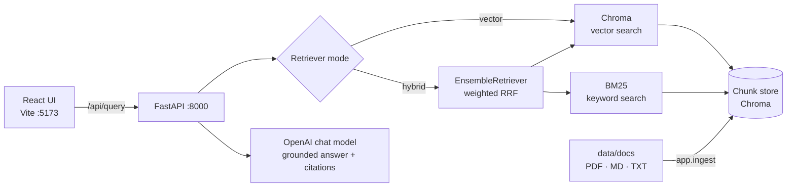

# Research Intelligence Platform

A multi-agent RAG research tool and company intelligence platform. You ask questions about your company documents (filings, reports, product docs, support guides), and it answers with cited sources. Retrieval quality is measured with RAGAS so every change is tracked in numbers.

**Stack:** Python 3.11+ · FastAPI · LangChain 1.x · ChromaDB · BM25 · OpenAI · RAGAS · React (Vite)

---

## Architecture



| Component | File | Notes |
|---|---|---|
| Config | [backend/app/config.py](backend/app/config.py) | All settings come from `backend/.env` |
| Ingestion | [backend/app/ingest.py](backend/app/ingest.py) | Loads PDF/MD/TXT, splits into chunks (1000 chars / 150 overlap), uses deterministic chunk IDs |
| Retrievers | [backend/app/retrievers.py](backend/app/retrievers.py) | Vector, BM25 and hybrid retrievers |
| RAG chain | [backend/app/rag.py](backend/app/rag.py) | Answers only from the numbered context passages and cites them inline |
| API | [backend/app/main.py](backend/app/main.py) | `GET /api/health`, `POST /api/query` |
| Evaluation | [backend/eval/](backend/eval/) | RAGAS runner, comparison, test-set drafting |
| Frontend | [frontend/src/App.jsx](frontend/src/App.jsx) | Query box, retriever toggle, answer with sources |

### Hybrid search

`EnsembleRetriever` combines two retrievers and merges their ranked results with weighted Reciprocal Rank Fusion:

- **BM25** finds exact tokens such as error codes (`TL-1042`), tickers, product names, and figures. Pure embeddings often miss these. Text is lowercased and split into word tokens, instead of BM25's default whitespace split.
- **Chroma vector search** handles paraphrased and conceptual questions.
- The BM25 index is built from the chunks already stored in Chroma, so both retrievers always search the same corpus.
- The fused list is cut back to `TOP_K`, so hybrid gets the same context budget as vector-only. This keeps the comparison fair.

Pick the mode with `RETRIEVER_MODE` in `.env`, or per request with `{"retriever": "vector" | "hybrid"}`.

---

## Quick start

Prerequisites: [uv](https://docs.astral.sh/uv/), Node 18+, and an OpenAI API key.

```bash
# 1. Backend
cd backend
uv sync                                  # creates .venv and installs app + dev + eval deps
cp .env.example .env                     # then set OPENAI_API_KEY
uv run python -m app.ingest              # index everything in data/docs
uv run uvicorn app.main:app --reload --port 8000

# 2. Frontend (new terminal)
cd frontend
npm install
npm run dev                              # http://localhost:5173

# 3. Smoke test (new terminal, backend running)
cd backend
uv run python scripts/smoke_test.py
```

The smoke test checks `/api/health`, sends one query in each retriever mode, and verifies that CORS allows the frontend origin. In development, Vite proxies `/api` to `:8000`.

### Using your own documents

Put PDF, Markdown, or text files in `backend/data/docs/` and re-run `uv run python -m app.ingest`. The two files already there are **fictional sample data** for testing the pipeline. Delete them when you add your own.

---

## Evaluation (RAGAS)

| Metric | What it measures |
|---|---|
| **Faithfulness** | Are the answer's claims supported by the retrieved context? Low scores mean hallucination. |
| **Answer relevancy** | Does the answer actually address the question? |
| **Context precision** | Are the relevant chunks ranked near the top of the retrieved list? Scored against the ground truth. |

### Test set

[backend/eval/testset.json](backend/eval/testset.json) holds 15–20 `{question, ground_truth}` pairs. The current set has 18 questions about the sample docs. It mixes exact lookups (error codes, figures), multi-fact answers, and synthesis questions.

To build a test set for your own documents:

```bash
uv run python -m eval.draft_testset --n 25   # writes eval/testset.draft.json
```

Review every draft by hand and fix or delete weak ones. Then copy 15–20 into `testset.json`. Unchecked LLM-written ground truths make the scores meaningless.

### Run it

```bash
cd backend
uv run python -m eval.run_ragas --mode vector --out eval/results/baseline.json
uv run python -m eval.run_ragas --mode hybrid --out eval/results/hybrid.json
uv run python -m eval.compare eval/results/baseline.json eval/results/hybrid.json --update-readme ../README.md
```

Each run saves its config, the mean scores, and per-question scores. `compare` prints the biggest per-question gains and drops in context precision, and fills in the table below.

### Results

<!-- RAGAS_RESULTS_START -->
| Metric | Baseline (vector) | Hybrid | Δ |
|---|---:|---:|---:|
| Faithfulness | _TBD_ | _TBD_ | _TBD_ |
| Answer relevancy | _TBD_ | _TBD_ | _TBD_ |
| Context precision | _TBD_ | _TBD_ | _TBD_ |

_N questions · top_k=4 · bm25_weight=0.5 · generator=… · judge=… · run YYYY-MM-DD_
<!-- RAGAS_RESULTS_END -->

**Findings:** _1–3 sentences: which questions improved (e.g. exact-code lookups), any regressions, and what to try next._

> LLM-judged metrics vary from run to run. Treat differences under ~0.02 as noise, and re-run before drawing conclusions.

---

## Configuration

| Variable | Default | Description |
|---|---|---|
| `OPENAI_API_KEY` | — | Required |
| `LLM_MODEL` | `gpt-4o-mini` | Model that generates answers |
| `EMBEDDING_MODEL` | `text-embedding-3-small` | Re-ingest after changing this |
| `EVAL_LLM_MODEL` | `gpt-4o-mini` | RAGAS judge model |
| `RETRIEVER_MODE` | `vector` | `vector` or `hybrid` |
| `TOP_K` | `4` | Number of chunks passed to the LLM |
| `BM25_WEIGHT` | `0.5` | Hybrid only; the vector weight is `1 - BM25_WEIGHT` |
| `CHUNK_SIZE` / `CHUNK_OVERLAP` | `1000` / `150` | Re-ingest after changing these |

## Project structure

```
backend/
  app/            config, ingest, retrievers, rag chain, FastAPI app
  data/docs/      source documents (sample data included)
  eval/           testset.json, run_ragas.py, compare.py, draft_testset.py, results/
  scripts/        smoke_test.py
frontend/         Vite + React UI
```

## Roadmap

- [x] Day 1: environment, baseline RAGAS, hybrid search, re-evaluation
- [ ] Docker / docker-compose
- [ ] Multi-agent orchestration (research planner, retriever, analyst, critic)
- [ ] Re-ranking (cross-encoder) and query rewriting
- [ ] Company intelligence connectors (filings, news)
